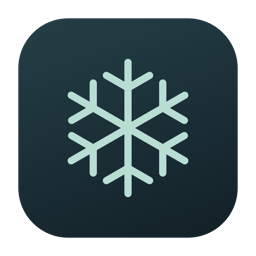
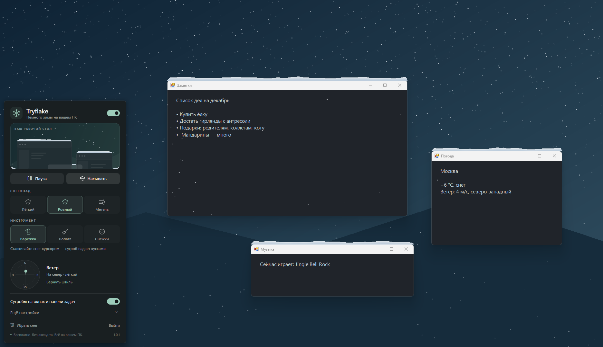

# Tryflake for Windows



Снег на рабочем столе Windows 11. Нативный порт
[Snow-Macbook (Tryflake для macOS)](https://github.com/byArto/Snow-Macbook):
C++20, Win32, Direct3D 11, DirectComposition, Direct2D и DirectWrite.
Один `Tryflake.exe` (~540 КБ) без установщика, рантаймов, .NET и сторонних библиотек.

Windows 10 1903+ / Windows 11, x64.

**[Скачать последнюю версию](https://github.com/Denmurzik/Tryflake-Windows/releases/latest/download/Tryflake.zip)**
· [Все выпуски](https://github.com/Denmurzik/Tryflake-Windows/releases)



## Установка

1. Распакуйте `Tryflake.zip` в любую папку, например `%LOCALAPPDATA%\Programs\Tryflake`.
2. Запустите `Tryflake.exe`. В области уведомлений появится снежинка — это настройки.
   Если её не видно, она может быть в скрытых значках (стрелка `^`).
3. Нажмите «Насыпать», чтобы сразу увидеть снег на краях окон.

Сборка не подписана. SmartScreen может показать предупреждение:
«Подробнее → Выполнить в любом случае».

Левый клик по снежинке открывает панель, правый — меню с паузой, очисткой
и выходом. Повторный запуск `Tryflake.exe` открывает панель уже работающей копии.
Автозапуск включается в «Ещё настройки».

## Управление

| Элемент | Действие |
| --- | --- |
| Переключатель справа от названия | Скрыть или показать снег |
| Пауза | Заморозить снег и физику, сохранив сугробы |
| Насыпать | Сразу добавить снег на края видимых окон и панели задач |
| Лёгкий / Ровный / Метель | Плотность и скорость снегопада |
| Варежка | Столкнуть снег с края окна кусками |
| Лопата | Снять широкую полосу снега |
| Снежки | Потянуть сугроб вдоль края окна, чтобы скатать шар |
| Компас | Перетащить точку: направление и сила ветра |
| Вернуть штиль | Убрать ветер |
| Убрать снег | Очистить сугробы и снежки, сохранив снегопад |

Снеговик: выберите «Снежки», скатайте три шара и перетащите меньшие на больший
(поднимите шар хотя бы на 15 точек). У верхнего появятся глаза, морковка и шарф.

Варежка и лопата всегда пропускают клики к окнам под снегом. В режиме снежков
слой принимает нажатие только над сугробом или шаром.

Панель управляется с клавиатуры: `Tab`/`Shift+Tab` — переход, `Пробел`/`Enter` —
нажать, стрелки — компас и ползунок, `Пробел` на компасе — штиль, `Esc` — закрыть,
`Ctrl+Q` — выйти.

## Сборка из исходников

Нужны Visual Studio 2022+ или Build Tools с компонентом
«Разработка классических приложений на C++» (MSVC + Windows SDK).
CMake не нужен.

```bat
build.cmd              :: build\Tryflake.exe, build\Tryflake.zip, build\SHA256SUMS
build.cmd test         :: 23 проверки физики и геометрии
build.cmd run          :: собрать и открыть с панелью
build.cmd diagnostics  :: проверка D3D, окон и PNG-кадр build\snow-preview.png
build.cmd clean
```

Шейдер HLSL компилируется `fxc` при сборке и вшивается в exe. CRT линкуется
статически, поэтому Visual C++ Redistributable не нужен.

## Как устроено

| macOS (оригинал) | Windows (порт) |
| --- | --- |
| SnowCore (Swift) | `src/core` — та же физика на C++20, без зависимостей от Win32 |
| `CGWindowListCopyWindowInfo`, 4 Гц | `EnumWindows` + `DWMWA_EXTENDED_FRAME_BOUNDS` + `DWMWA_CLOAKED`; WinEvent-хуки дают мгновенную реакцию на перемещение, таймер 4 Гц — страховка |
| Dock | Панель задач (`Shell_TrayWnd`) |
| `NSPanel` поверх всех Spaces, `ignoresMouseEvents` | Окно `WS_EX_TOPMOST \| WS_EX_TOOLWINDOW \| WS_EX_LAYERED \| WS_EX_TRANSPARENT \| WS_EX_NOREDIRECTIONBITMAP` на каждом мониторе; видно на всех виртуальных рабочих столах |
| Metal, `MTKView` | Direct3D 11, swap chain для композиции + DirectComposition (premultiplied alpha) |
| Строка меню + `NSPopover` (SwiftUI) | Значок в области уведомлений + флайаут на Direct2D/DirectWrite (Segoe UI Variable, Segoe Fluent Icons, скругление DWM) |
| `UserDefaults` | `HKCU\Software\Tryflake` |
| `SMAppService` | `HKCU\...\CurrentVersion\Run` (+ проверка «Автозагрузки» в Параметрах) |
| Low Power Mode, нагрев | Экономия энергии Windows (`GUID_ENERGY_SAVER_STATUS`, `SystemStatusFlag`) |
| Сон, выключенный дисплей, неактивный сеанс | `PBT_APMSUSPEND`, `GUID_CONSOLE_DISPLAY_STATE`, блокировка сеанса (WTS) |
| `CVDisplayLink` 60 к/с | Такт композитора (`DCompositionWaitForCompositorClock`, иначе `DwmFlush`), ограничение 60 к/с, 30 к/с в экономии |

Координаты физики — логические точки (DIP) каждого монитора, поэтому снег
выглядит одинаково при масштабе 100–200% и на мониторах с разным DPI
(Per-Monitor DPI Awareness v2).

Читаются только прямоугольники окон и их порядок. Заголовки, содержимое
и изображение экрана не захватываются. Сетевых запросов нет.

Когда ничего не анимируется (пауза, снег выключен, сон), цикл кадров
останавливается и процесс не тратит CPU. Во время снегопада — около 1–2% одного ядра.

## Проверка без интерфейса

```bat
build\Tryflake.exe --diagnostics --windows --chunks --render-preview build\snow-preview.png
```

Создаёт настоящее устройство Direct3D, выполняет 1200 шагов симуляции, рисует
кадр на GPU в PNG и выводит JSON с видеокартой, числом мониторов, найденными
краями окон (только координаты) и временем расчёта.
`--show-settings` открывает панель при запуске, `--smoke-test` закрывает приложение через 8 секунд.

## Ограничения

- Эксклюзивный полноэкранный режим некоторых игр перекрывает любые сторонние слои.
  Оконный и «оконный без рамки» режимы работают.
- Форма окон приближена прямоугольником рамки DWM. У развёрнутого окна верхний
  край у кромки экрана, поэтому снег на нём не копится; сугробы остаются
  на горизонтальной панели задач и на неразвёрнутых окнах.
- Снежки перемещаются в пределах одного монитора.
- Безопасный рабочий стол (UAC, экран блокировки) скрывает сторонние окна. Снег возвращается после разблокировки.

## Лицензия

[MIT](LICENSE). Порт основан на Snow-Macbook © Tryflake contributors.
